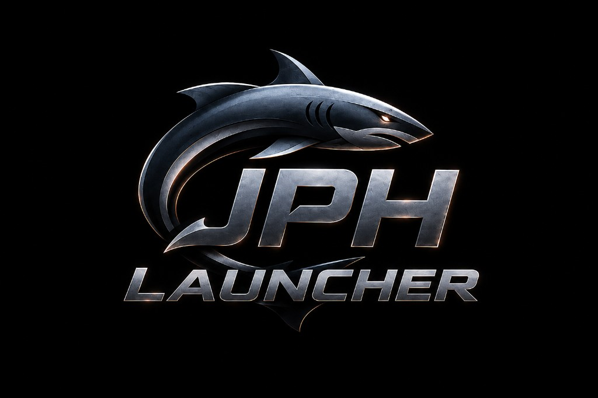

# JPH Launcher

<p align="center">
  
</p>

Ein Minecraft-Launcher für den Mac. Gebaut als Lernprojekt, um zu sehen, wie so ein Launcher das Spiel wirklich startet: welche Java-Version, welches Profil, welche Mods, und wo die Welt liegt.

Die Oberfläche ist eine eigene Mac-App. Kein Browserfenster, kein graues Panel. Schwarz, die Schrift hell, Gold nur an der Stelle, die gerade zählt.

## Was er kann

- Minecraft Java starten. Eingestellt ist 26.3, mit Fabric.
- Drei Seiten: Start, Skins, Mods.
- Beim Start ein Ladebalken, der den echten Fortschritt aus dem Spiel-Log liest.
- Skins wechseln zwischen dem eigenen Skin, Steve und Alex. Der Skin liegt als Resource Pack in der Welt.
- Mods suchen und selbst entscheiden. **Add** legt einen Mod in den Ordner, **In** nimmt ihn wieder raus. Nichts ist vorausgewählt, außer dem, was der Launcher selbst braucht.
- **JPH Mod** steht in der Mod-Liste immer oben. Im Spiel öffnet Rechts-Shift eine Liste: Flug, Geschwindigkeit, Reichweite, Velocity, Fullbright und weitere Werte, die sich einstellen lassen. Die gelten in einer Einzelspieler-Welt.
- Einstellungen über das Zahnrad: RAM, Vollbild, Instanzen, das Log vom letzten Start, und ein Konto-Knopf.

## Was er nicht kann

Multiplayer. Die Anmeldung im offiziellen Launcher gehört Mojang und wandert nicht mit. JPH braucht dafür eine eigene App-Nummer, die Mojang freigibt. Der Knopf unter dem Zahnrad ist dafür vorbereitet. Solange die Nummer fehlt, bleiben echte Server zu. Dafür reicht der normale Minecraft-Launcher.

## Start

Die App liegt neben diesem Ordner: `JPH Launcher.app`. Ordner und App zusammen lassen. Der Pfad steht fest in `mac/main.swift`.

Neu bauen, nach einer Änderung am Quelltext:

```bash
swiftc -O -framework AppKit -o "../JPH Launcher.app/Contents/MacOS/JPHLauncher" mac/main.swift
codesign --force --sign - "../JPH Launcher.app"
```

Python für den Start:

```bash
python3 -m venv .venv
.venv/bin/pip install -r requirements.txt
```

Minecraft muss auf dem Mac schon installiert sein. Der Launcher legt seine eigene Spielkopie unter `game/` an und fasst die Welten des offiziellen Launchers nicht an.
